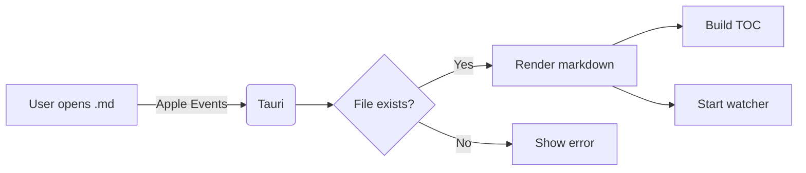
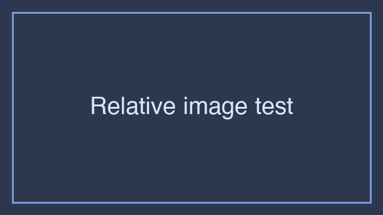

# MD Viewer — Feature Showcase

This file exercises every renderer in the app. Open it to verify a release build.

## Typography

A paragraph with **bold**, *italic*, ***both***, ~~strikethrough~~, `inline code`,
and a [link to a heading](#code-blocks). Emphasis chains together: *italic with **bold inside***.

> Blockquotes get a left border, tinted background, and slightly muted text — useful for
> pull-quotes or callouts that aren't quite info-boxes.

A horizontal rule:

---

## Lists

### Unordered

- First item
- Second item
  - Nested
  - Deeper still
    - And again
- Back to root

### Ordered

1. Step one
2. Step two
3. Step three

### Task list (GFM)

- [x] Render frontmatter as chips
- [x] Highlight `code` inline
- [ ] Add cross-file search
- [ ] Notarize with Apple Developer ID

## Tables

| Feature       | Implemented | Notes                          |
| ------------- | :---------: | ------------------------------ |
| GFM tables    |     ✅      | striped rows                   |
| Task lists    |     ✅      | checkboxes inert by design     |
| Math (KaTeX)  |     ✅      | inline + display               |
| Mermaid       |     ✅      | lazy render, theme-aware       |
| File watcher  |     ✅      | debounced 150ms                |

## Code blocks

Inline code: `const answer = 42;`.

Highlighted block:

```ts
import { invoke } from "@tauri-apps/api/core";

async function readFile(path: string): Promise<string> {
  const file = await invoke<{ content: string }>("read_markdown_file", { path });
  return file.content;
}
```

```rust
#[tauri::command]
fn copy_to_vault(src: String, vault: String) -> Result<String, String> {
    let dest = std::path::Path::new(&vault).join(
        std::path::Path::new(&src).file_name().ok_or("no name")?
    );
    std::fs::copy(&src, &dest).map_err(|e| e.to_string())?;
    Ok(dest.to_string_lossy().to_string())
}
```

```bash
pnpm tauri build
xattr -dr com.apple.quarantine "/Applications/MD Viewer.app"
```

## Math (KaTeX)

Inline: $E = mc^2$ and $\sum_{i=1}^{n} i = \frac{n(n+1)}{2}$.

Display:

$$
f(x) = \int_{-\infty}^{\infty} \hat{f}(\xi)\, e^{2\pi i \xi x}\, d\xi
$$

$$
\begin{pmatrix}
a & b \\
c & d
\end{pmatrix}
\begin{pmatrix}
x \\
y
\end{pmatrix}
=
\begin{pmatrix}
ax + by \\
cx + dy
\end{pmatrix}
$$

## Mermaid diagram



## Linkify

Plain URL: https://tauri.app gets autolinked.
Email handling is disabled by default.

## Images

If a relative image lives next to this file, it renders. Example:



External images load directly:


